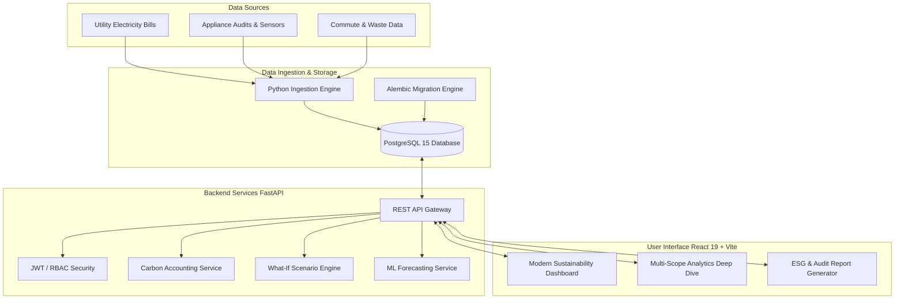

# Carbon Footprint Analysis & Smart Campus Sustainability Intelligence Platform

[](https://www.python.org/)
[](https://fastapi.tiangolo.com/)
[](https://react.dev/)
[](https://vitejs.dev/)
[](https://www.postgresql.org/)
[](LICENSE)

An enterprise-grade, AI-driven carbon accounting and sustainability intelligence platform designed for institutional campuses. Built to automate greenhouse gas (GHG) tracking across Scope 1, Scope 2, and Scope 3 emissions in alignment with ISO 14064 standards and the GHG Protocol.

---

## 🌟 Key Features

- **Automated Multi-Scope Carbon Accounting**:
  - **Scope 1 (Direct)**: On-campus fuel combustion, generator activity, institutional transport.
  - **Scope 2 (Indirect - Energy)**: High-resolution electricity consumption tracking, power factor metrics, and billing demand data.
  - **Scope 3 (Value Chain)**: Commuter travel, municipal water supply, electronic and solid waste lifecycle.
- **Automated Data Ingestion Engine**:
  - Ingestion pipeline tailored for VESIT campus electricity utility bills, appliance inventory audits, and operational datasets.
  - Fault-tolerant parsing with unit conversions and automatic emission factor mappings.
- **Dynamic Executive Sustainability Dashboard**:
  - Real-time KPIs for gross emissions ($t\text{CO}_2e$), per-capita intensity, renewable offsets, and budget expenditures.
  - Interactive visual analytics powered by Recharts (Scope donut distributions, departmental rankings, and monthly trajectories).
- **Machine Learning & Time-Series Forecasting**:
  - Predictive modeling for future energy demand and carbon emission trends with confidence intervals.
- **What-If Policy Simulation**:
  - Interactive scenario simulator for evaluating high-impact interventions (e.g., solar rooftop installations, HVAC scheduling, green fleet transitions).
- **AI-Powered Prescriptive Decarbonization**:
  - Intelligent recommendation cards ranking interventions by ROI, payback periods, and emission reduction potential.
- **Audit & ESG Compliance Reporting**:
  - One-click generation of audit-ready compliance summaries and CSV/JSON export capabilities for stakeholder disclosure.

---

## 🏗 System Architecture



---

## 📂 Repository Structure

```
carbon_footprint_analysis/
├── backend/                  # FastAPI Application
│   ├── alembic/              # Database migration version scripts
│   ├── app/
│   │   ├── api/v1/           # API routes (auth, analytics, electricity, etc.)
│   │   ├── core/             # Configuration, JWT security, database sessions
│   │   ├── db/               # Database initialization and seed data
│   │   ├── models/           # SQLAlchemy ORM database models
│   │   ├── schemas/          # Pydantic request/response validation schemas
│   │   └── services/         # Calculation engine, simulation & AI recommendations
│   ├── tests/                # Automated pytest suite
│   ├── Dockerfile            # Container definition for backend service
│   ├── docker-compose.yml    # Full-stack container orchestration
│   └── requirements.txt      # Python dependencies
├── frontend/                 # Modern React 19 + Vite Application
│   ├── public/               # Static assets, SVG icons, and manifests
│   ├── src/
│   │   ├── components/       # Reusable UI cards, charts, forms, and layout
│   │   ├── pages/            # View pages (Dashboard, Analytics, Simulation, etc.)
│   │   ├── services/         # Axios API clients for backend endpoints
│   │   └── utils/            # Numeric formatters and date helpers
│   ├── package.json          # Node dependencies and scripts
│   └── vite.config.js        # Vite build configuration
├── database/                 # Database schema and seed assets
│   ├── schema/init.sql       # Baseline schema definition
│   └── data/vesit/           # Institutional audit and bill source records
├── python/                   # Data processing and batch ingestion
│   └── ingestion/            # Pipeline scripts for utility data parsing
└── .gitignore                # Production git ignore definitions
```

---

## 🚀 Quickstart & Installation

### Option 1: Docker Compose (Recommended)

Run the entire backend stack and PostgreSQL database with a single command:

```bash
cd backend
docker-compose up --build -d
```

The FastAPI backend will automatically run database migrations and start on:
- API Root: `http://localhost:8000`
- Interactive Swagger UI: `http://localhost:8000/docs`

---

### Option 2: Local Setup

#### 1. Backend Setup

```bash
# Navigate to backend directory
cd backend

# Create and activate Python virtual environment
python -m venv venv
# On Windows:
.\venv\Scripts\activate
# On Linux/macOS:
source venv/bin/activate

# Install dependencies
pip install -r requirements.txt

# Configure environment variables
cp .env.example .env

# Run database migrations
alembic upgrade head

# Start development server
uvicorn app.main:app --host 0.0.0.0 --port 8000 --reload
```

#### 2. Run Data Ingestion Pipeline (VESIT Data)

```bash
# Ingest raw Excel utility bills and campus infrastructure records
python python/ingestion/vesit_ingestion.py
```

#### 3. Frontend Setup

```bash
# Navigate to frontend directory
cd frontend

# Install Node dependencies
npm install

# Start Vite development server
npm run dev
```

The frontend will be available at:
- Web App: `http://localhost:5173`

---

## 🧪 Testing & Code Quality

Run backend test suite:
```bash
cd backend
pytest
```

Run frontend production build and linting:
```bash
cd frontend
npm run build
npm run lint
```

---

## 🛡 Security & Compliance

- **JWT Authentication**: OAuth2 Password bearer flow with role-based access control (Admin, Auditor, Department Officer).
- **Environment Isolation**: `.env` and sensitive production secrets are strictly excluded from version control.
- **Standards Alignment**: Follows ISO 14064-1 specification for quantification and reporting of greenhouse gas emissions and removals.

---

## 📄 License

This project is licensed under the MIT License - see the [LICENSE](LICENSE) file for details.
